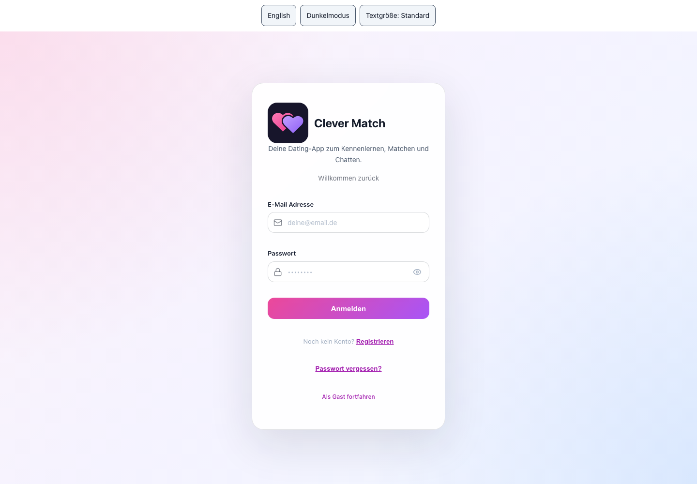
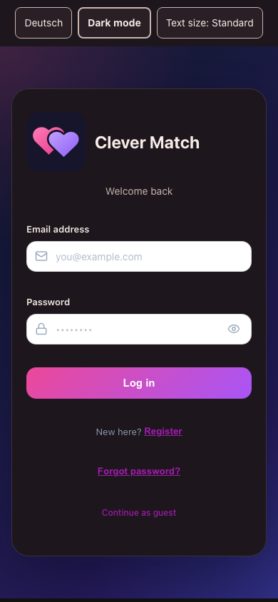

# Clever Match

[Deutsch](README.md) | **English**

[Live app](https://clevermatch.onrender.com/)

Clever Match is a dating app for meeting new people, finding compatible matches, and chatting. The frontend and backend run on Render, with data stored in MongoDB Atlas.



## Features

- Registration with mandatory email confirmation, sign-in, and individual guest access
- Profile editing and discovering new people
- Search preferences with age range and distance slider
- Save interests, hobbies, and dating intentions in your profile
- Likes, one shared conversation per mutual match, and live chat
- Events and event registration
- Private profiles and user blocking
- German and English interface, light and dark themes
- Keyboard navigation, visible focus indicators, larger text, and reduced motion

## Mobile view



The screenshots show the current sign-in page: German in light mode and English in dark mode.

## Development status

Existing accounts must also confirm their email address. A new confirmation link can be requested on the sign-in page. Unconfirmed accounts cannot access profiles, matches, or chat; older guest sessions can be replaced by starting a new guest session.

Clever Match remains free. Password reset through Resend, saved notification preferences, and protected chats are implemented. Email delivery requires the service variables described below. A complete WCAG conformance assessment has not been performed.

## Run locally

Requirements: Node.js 22, npm, and an accessible MongoDB database.

```bash
git clone https://github.com/michkffm/clever-match.git
cd clever-match
npm ci
cp backend/.env.example backend/.env
cp frontend/.env.example frontend/.env.local
npm run build -w packages/types
npm run dev:all
```

Before starting, enter your MongoDB URI and a random JWT secret of at least 32 characters in `backend/.env`. Never commit real credentials.

Frontend: `http://localhost:5173` · API: `http://localhost:5000/api`

## Check and build

```bash
npm run type-check
npm run lint
npm run test:api
npm run test:e2e
npm audit
npm run build
npm run start:backend
```

Additional Safari-engine mobile layout checks: `npx playwright install webkit`, then `npx playwright test e2e/mobile-layout.spec.ts --browser=webkit`. This does not replace testing on a physical iPhone.

The production build compiles the shared types first, followed by the frontend and backend. Browser checks start a local frontend test server. API tests use a temporary local MongoDB without production data; the MongoDB test binary is downloaded on the first run.

## Technologies and structure

| Area | Technologies / directory |
| --- | --- |
| Frontend | React, TypeScript, Vite, Zustand · `frontend/` |
| Backend | Node.js, Express, Mongoose, WebSocket · `backend/` |
| Database | MongoDB Atlas |
| Shared types | TypeScript · `packages/types/` |
| Browser checks | Playwright · `e2e/` |
| Deployment | Render Blueprint · `render.yaml` |

## Configuration and deployment

Required variables are documented without secret values in `backend/.env.example` and `frontend/.env.example`. `render.yaml` defines the API and static frontend.

- `MONGODB_URI`: MongoDB connection; store it as a secret on Render
- `JWT_SECRET`: random signing key for session tokens
- `CORS_ORIGIN`: allowed frontend origin
- `VITE_API_HOST` or `VITE_API_URL`: backend address used by the frontend
- `CLOUDINARY_URL`: required for profile photo uploads
- `ENABLE_DEMO_SEED`: only for explicitly enabled local demo data

Password reset requires `RESEND_API_KEY`, `MAIL_FROM` (a verified sender domain), and `APP_ORIGIN`. Secrets are stored only locally or in the hosting service.

## Security and privacy

Public profiles do not expose email addresses or exact coordinates. Access tokens are short-lived and held only in browser memory. Chat access requires an active mutual match. Local `.env` files, dependencies, and build output are excluded from Git.

## Author

Michael Koch · [GitHub](https://github.com/michkffm) · [Portfolio](https://michael-koch-portfolio.vercel.app/)
