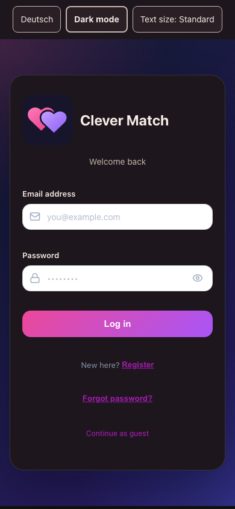

# Clever Match

**Deutsch** | [English](README.en.md)

[Live-App](https://clevermatch.onrender.com/)

Clever Match ist eine Dating-App, um neue Menschen kennenzulernen, passende Matches zu finden und miteinander zu chatten. Frontend und Backend laufen auf Render; die Daten werden in MongoDB Atlas gespeichert.


## Funktionen

- Registrierung mit verpflichtender E-Mail-Bestätigung, Anmeldung und eigener Gastzugang
- Profile bearbeiten und neue Menschen kennenlernen
- Suchkriterien mit Altersbereich und Entfernungsschieberegler
- Interessen und Hobbys sowie Dating-Wünsche im Profil speichern
- Likes, ein gemeinsames Gespräch pro gegenseitigem Match und Live-Chat
- Events und Event-Anmeldungen
- Private Profile und Blockieren anderer Nutzer
- Deutsche und englische Oberfläche, Hell- und Dunkelmodus
- Bedienung per Tastatur, sichtbare Fokusmarkierung, größere Schrift und reduzierte Bewegung

## Mobile Ansicht



Die Screenshots zeigen die aktuelle Anmeldung: Deutsch im Hellmodus und Englisch im Dunkelmodus.

## Entwicklungsstand

Bestehende Konten müssen ihre E-Mail ebenfalls bestätigen. Auf der Anmeldeseite kann ein neuer Bestätigungslink angefordert werden. Unbestätigte Konten erhalten keinen Zugriff auf Profile, Matches oder Chat; bisherige Gastzugänge können durch einen neuen Gastzugang ersetzt werden.

Clever Match bleibt kostenlos. Passwort-Reset über Resend, gespeicherte Benachrichtigungseinstellungen und geschützte Chats sind implementiert. Der E-Mail-Versand benötigt die unten beschriebenen Dienstvariablen. Eine vollständige Prüfung auf WCAG-Konformität wurde noch nicht durchgeführt.

## Lokal starten

Voraussetzungen: Node.js 22, npm und eine erreichbare MongoDB-Datenbank.

```bash
git clone https://github.com/michkffm/clever-match.git
cd clever-match
npm ci
cp backend/.env.example backend/.env
cp frontend/.env.example frontend/.env.local
npm run build -w packages/types
npm run dev:all
```

Trage vor dem Start die MongoDB-URI und einen zufälligen JWT-Schlüssel mit mindestens 32 Zeichen in `backend/.env` ein. Echte Zugangsdaten gehören niemals ins Repository.

Frontend: `http://localhost:5173` · API: `http://localhost:5000/api`

## Prüfen und bauen

```bash
npm run type-check
npm run lint
npm run test:api
npm run test:e2e
npm audit
npm run build
npm run start:backend
```

Zusätzliche Safari-Engine-Prüfung für das mobile Layout: `npx playwright install webkit` und `npx playwright test e2e/mobile-layout.spec.ts --browser=webkit`. Diese Prüfung ersetzt keinen Test auf einem echten iPhone.

Der Produktionsbuild erstellt zuerst die gemeinsamen Typen, danach Frontend und Backend. Die Browserprüfungen starten einen lokalen Frontend-Testserver. Die API-Tests verwenden eine temporäre lokale MongoDB ohne Produktionsdaten; beim ersten Lauf wird die MongoDB-Testversion heruntergeladen.

## Technologien und Struktur

| Bereich | Technologien / Verzeichnis |
| --- | --- |
| Frontend | React, TypeScript, Vite, Zustand · `frontend/` |
| Backend | Node.js, Express, Mongoose, WebSocket · `backend/` |
| Datenbank | MongoDB Atlas |
| Gemeinsame Typen | TypeScript · `packages/types/` |
| Browserprüfungen | Playwright · `e2e/` |
| Bereitstellung | Render Blueprint · `render.yaml` |

## Konfiguration und Bereitstellung

Die benötigten Variablen sind ohne geheime Werte in `backend/.env.example` und `frontend/.env.example` dokumentiert. `render.yaml` beschreibt die API und das statische Frontend.

- `MONGODB_URI`: MongoDB-Verbindung, auf Render als Secret speichern
- `JWT_SECRET`: zufälliger Schlüssel für Sitzungstokens
- `CORS_ORIGIN`: erlaubte Frontend-Adresse
- `VITE_API_HOST` oder `VITE_API_URL`: Backend-Adresse für das Frontend
- `CLOUDINARY_URL`: erforderlich für Profilfoto-Uploads
- `ENABLE_DEMO_SEED`: nur für ausdrücklich aktivierte lokale Demo-Daten

Für Passwort-Reset werden `RESEND_API_KEY`, `MAIL_FROM` (verifizierte Absenderdomain) und `APP_ORIGIN` benötigt. Secrets werden ausschließlich lokal oder im Hosting-Dienst gespeichert.

## Sicherheit und Datenschutz

Öffentliche Profile geben keine E-Mail-Adressen oder genauen Koordinaten aus. Access-Tokens sind kurzlebig und werden im Browser nur im Arbeitsspeicher gehalten. Chat-Zugriff setzt ein aktives gegenseitiges Match voraus. Lokale `.env`-Dateien, Abhängigkeiten und Build-Ausgaben sind von Git ausgeschlossen.

## Autor

Michael Koch · [GitHub](https://github.com/michkffm) · [Portfolio](https://michael-koch-portfolio.vercel.app/)
